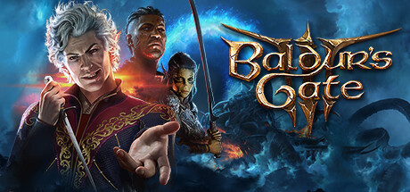

**Baldur's Gate 3 by Larian Studios (2023) is the definitive CRPG of the current generation.**

---

## 📖 About

Baldur's Gate 3 by Larian Studios (2023) is the definitive CRPG of the current generation. Built on D&D 5th Edition rules, it offers hundreds of hours of branching story, tactical combat, and companion drama. Honour Mode's single save and permanent death make it the ultimate test of mastery.

## ⚠️ Problems Without Trainer

| Problem | Status |
|---------|--------|
| Honour Mode permadeath wipes entire campaigns to a single missed saving throw | ✅ Solved |
| Action economy understanding required to survive high-difficulty act 3 encounters | ✅ Solved |
| Companion approval locks dialogue branches without careful relationship management | ✅ Solved |
| Spell slot scarcity forces long rest timing decisions with narrative consequences | ✅ Solved |
| Legendary action boss fights punish unprepared parties with unavoidable wipes | ✅ Solved |

## ✅ Solution

The **Baldur's Gate 3 Trainer** solves all these issues, giving you complete control so you can focus on enjoying the game.

## 🎯 Features

- Unlimited Resources / Currency
- God Mode / Invincibility
- Instant Skill & Ability Cooldown
- One-Hit Kill
- Freeze Timers
- Unlock All Items & Achievements
- Custom Speed Multiplier
- Infinite Stamina / Energy

## 🚀 Quick Start

1. **Disable Windows Defender** temporarily (trainer may trigger false positive)
2. Get the trainer from the button above
3. Launch Baldur's Gate 3
4. Run the trainer as Administrator
5. Use the hotkeys to activate cheats in-game

## 💎 Free vs Pro

| Feature | Free | Pro |
|---------|------|-----|
| God Mode | ✅ | ✅ |
| Unlimited Resources | ✅ | ✅ |
| Advanced Cheats | ❌ | ✅ |
| Auto-Updates | ❌ | ✅ |
| Priority Support | ❌ | ✅ |

## 💻 Requirements

- Windows 10 / 11 (64-bit)
- Baldur's Gate 3 (any version)
- .NET Framework 4.8+
- DirectX 11+

## 🍎 macOS

## ⚖️ Legal

Educational and single-player use only.

---

